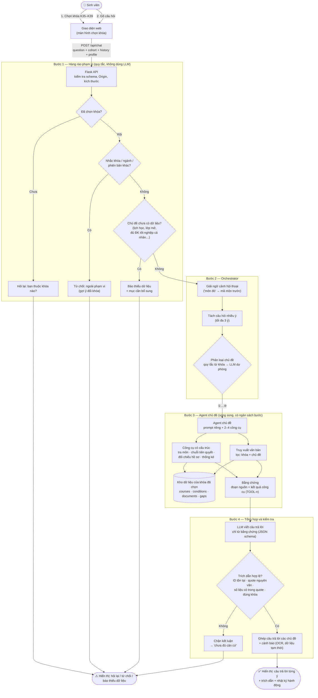
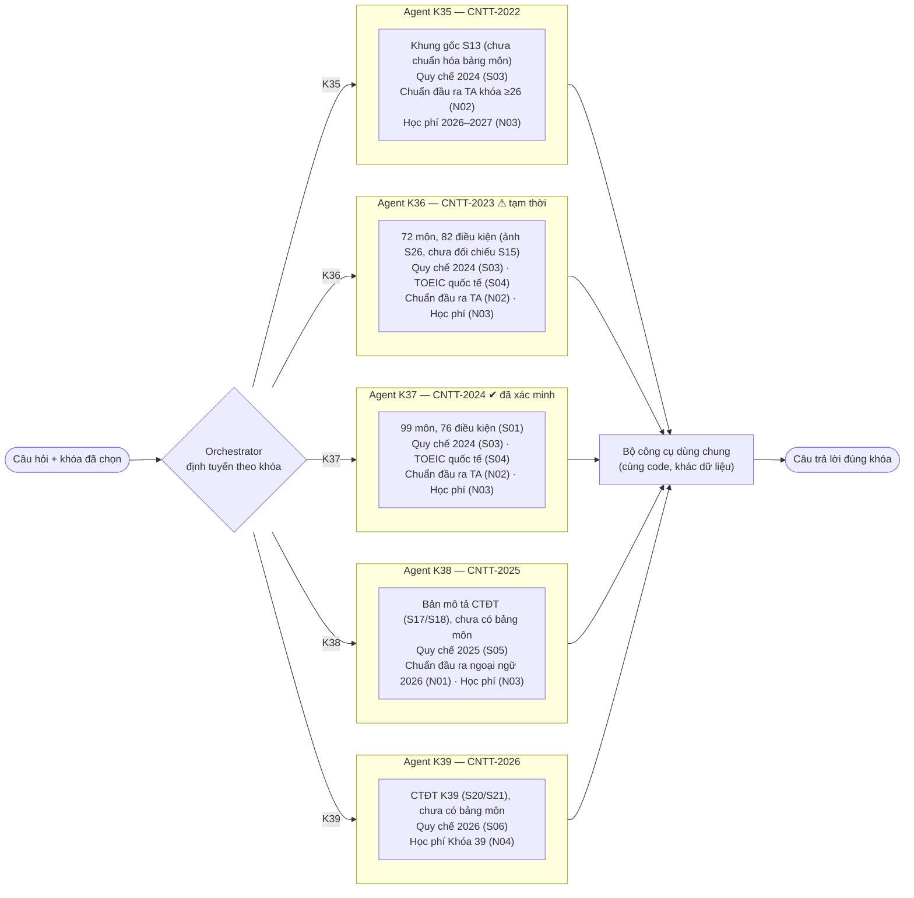
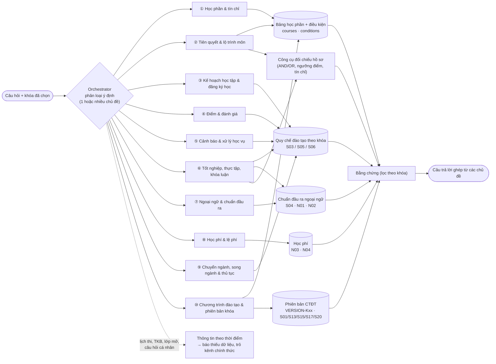
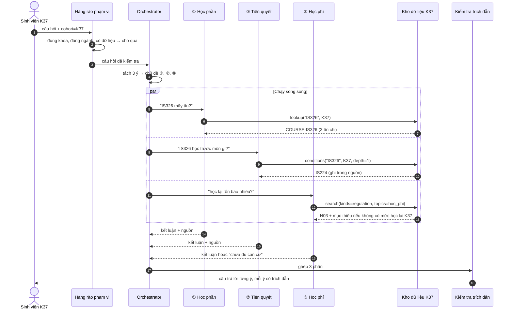
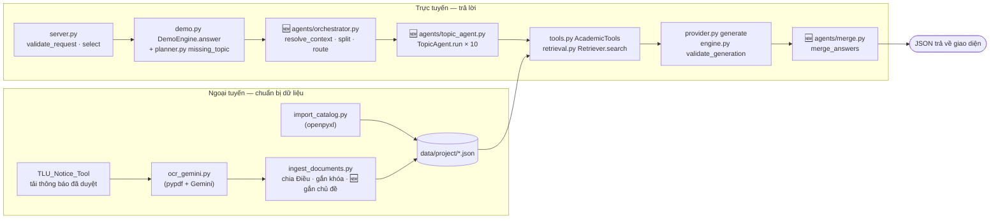
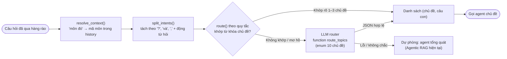

# Thiết kế đa agent: điều phối theo cụm vấn đề (phương án 2)

**Quyết định:** hệ thống dùng **một agent điều phối (Orchestrator)** phân loại câu hỏi vào **10 agent
chuyên đề**. **Khóa** (K35–K39) không thành agent riêng mà là **phạm vi bắt buộc** truyền cho mọi agent:
agent nào cũng chỉ đọc dữ liệu của khóa sinh viên đã chọn.

Tài liệu gồm: luồng dữ liệu tổng quát (§1), hai phương án và so sánh (§2–§4), 10 chủ đề kèm câu hỏi
mẫu (§5), và **chi tiết triển khai từng bước** — module, hàm, thư viện, quy tắc (§6). Ký hiệu:
✅ đã có trong code · 🆕 cần làm.

> Trạng thái dữ liệu (11/2026): K37 đã xác minh (99 môn), K36 tạm thời (72 môn trích từ ảnh),
> K35/K38/K39 có thông tin phiên bản; toàn văn quy chế 2024/2025/2026, TOEIC, chuẩn đầu ra, học phí.

---

## 1. Luồng dữ liệu tổng quát (theo phương án 2)



---

## 2. Phương án 1 — Agent con theo khóa (tham khảo, không chọn)



---

## 3. Phương án 2 — Agent con theo cụm vấn đề (đã chọn)



---

## 4. So sánh hai phương án

| Tiêu chí | Phương án 1: theo khóa | Phương án 2: theo chủ đề ✔ |
|---|---|---|
| Orchestrator có quyết định gì | Gần như không — khóa đã chọn ở giao diện | Có: phân loại ý định, tách câu nhiều ý |
| Trùng lặp | Cao: 5 agent cùng logic, chỉ khác dữ liệu | Thấp: mỗi agent một chuyên môn |
| Prompt và công cụ | Chung chung, agent nào cũng cần đủ mọi công cụ | Chuyên biệt: 2–4 công cụ/agent → ít chọn nhầm |
| Cô lập dữ liệu theo khóa | Tự nhiên (mỗi agent một kho) | Truyền khóa làm bộ lọc — đã có sẵn trong `Catalog` |
| Câu hỏi nhiều ý | Một agent xử lý hết | Tách cho nhiều agent chạy song song |
| Bổ sung khóa mới (K40) | Thêm 1 agent mới | Chỉ thêm dữ liệu, không đổi agent |
| Bổ sung chủ đề mới | Sửa cả 5 agent | Thêm 1 agent |
| Đánh giá trong NCKH | Khó tạo khác biệt so với agent đơn | Đo được độ chính xác định tuyến và độ đúng theo chủ đề |
| Ưu điểm nổi bật | Dễ giải thích phạm vi; cập nhật từng khóa độc lập | Định tuyến có ý nghĩa, mở rộng tốt, phù hợp nghiên cứu |
| Nhược điểm chính | Định tuyến tầm thường, trùng lặp | Cần bộ phân loại chủ đề tốt; câu hỏi giáp ranh 2 chủ đề |

---

## 5. Mười chủ đề và câu hỏi mẫu

| # | Agent chủ đề | Dữ liệu / công cụ | Câu hỏi sinh viên có thể hỏi |
|---|---|---|---|
| ① | **Học phần & tín chỉ** | Bảng học phần; tra môn, thống kê danh mục | "IT320 mấy tín chỉ?" · "Môn CSDL là môn nào?" · "Chương trình có bao nhiêu môn bắt buộc?" · "Nhóm lựa chọn ngành có những môn gì?" · "Học máy là môn bắt buộc hay tự chọn?" |
| ② | **Tiên quyết & lộ trình môn** | Bảng điều kiện; lần chuỗi, đối chiếu hồ sơ | "Muốn học Học máy phải qua môn gì?" · "Lộ trình để học Phân tích mã độc?" · "Tôi đạt CS122 rồi, học IT320 được chưa?" · "Rớt Giải tích 1 có học Giải tích 2 được không?" · "Học xong OOP thì học tiếp được môn nào?" |
| ③ | **Kế hoạch học tập & đăng ký học** | Quy chế (đăng ký học), kế hoạch đào tạo năm học | "Một kỳ được đăng ký tối đa bao nhiêu tín chỉ?" · "Học kỳ phụ là gì, ai được đăng ký?" · "Kỳ đầu có phải tự đăng ký môn không?" · "Năm học 2026–2027 bắt đầu khi nào?" · "Nên phân bổ các môn cơ sở thế nào?" |
| ④ | **Điểm & đánh giá** | Quy chế (đánh giá, thi lại, thang điểm) | "Điểm dưới bao nhiêu phải thi lại?" · "Điểm chữ B+ bằng bao nhiêu thang 4?" · "Điểm quá trình dưới 4 thì sao?" · "Học cải thiện điểm lấy điểm nào?" · "Phúc tra điểm thi nộp ở đâu, khi nào?" |
| ⑤ | **Cảnh báo & xử lý học vụ** | Quy chế (cảnh báo, buộc thôi học, nghỉ học tạm thời, bảo lưu) | "Khi nào bị cảnh báo học tập?" · "Nợ bao nhiêu tín chỉ thì bị buộc thôi học?" · "Bảo lưu kết quả học tập được bao lâu?" · "Nghỉ học tạm thời cần thủ tục gì?" · "Thời gian học tối đa là bao lâu?" |
| ⑥ | **Tốt nghiệp, thực tập, khóa luận** | Quy chế (công nhận, xếp hạng); điều kiện IP406/IT499; đối chiếu hồ sơ | "Điều kiện làm khóa luận là gì?" · "TBTL bao nhiêu thì tốt nghiệp loại giỏi?" · "Không làm khóa luận thì học gì thay?" · "Một năm xét tốt nghiệp mấy đợt?" · "Học lại nhiều có bị hạ hạng tốt nghiệp không?" |
| ⑦ | **Ngoại ngữ & chuẩn đầu ra** | TOEIC quốc tế (S04), chuẩn đầu ra (N01/N02), quy đổi chứng chỉ | "Cần bao nhiêu điểm TOEIC để tốt nghiệp?" · "TOEIC 4 kỹ năng tính thế nào?" · "Chứng chỉ hết hạn có được xét không?" · "Có IELTS thì được miễn học tiếng Anh không?" · "K38 dùng chứng chỉ nào thay TOEIC được?" |
| ⑧ | **Học phí & lệ phí** | Học phí 2026–2027 (N03), học phí K39 (N04) | "Học phí ngành CNTT K37 năm nay bao nhiêu?" · "Học phí K39 mỗi kỳ?" · "Học lại một môn tốn bao nhiêu?" · "Được miễn giảm học phí theo diện nào?" · "Lệ phí thi lại là bao nhiêu?" |
| ⑨ | **Chuyển ngành, song ngành & thủ tục** | Quy chế (chuyển ngành, hai chương trình, trao đổi) | "Chuyển sang ngành Trí tuệ nhân tạo cần điều kiện gì?" · "Có được học song ngành không?" · "Môn đã học có được công nhận khi chuyển ngành?" · "Xin giấy xác nhận sinh viên ở đâu?" · "Chuyển trường có được không?" |
| ⑩ | **Chương trình đào tạo & phiên bản khóa** | VERSION-Kxx, khung CTĐT, bản mô tả CTĐT | "Chương trình K38 bao nhiêu tín chỉ, học mấy năm?" · "Khung chương trình khóa mình theo quyết định nào?" · "K36 khác K37 ở những môn nào?" · "Chuẩn đầu ra của ngành CNTT là gì?" · "Dữ liệu của khóa mình đã đầy đủ chưa?" |
| — | *Thông tin theo thời điểm* (không trả lời) | Mục dữ liệu thiếu (gaps) | "Lịch thi kỳ này?" · "Lớp IT320 còn chỗ không?" · "Thầy nào dạy Python?" · "Em đủ điều kiện tốt nghiệp chưa?" |

### Ví dụ câu hỏi nhiều ý

> "Khai phá dữ liệu mấy tín, học trước môn gì, và nếu rớt thì học lại tốn bao nhiêu?" — sinh viên K37



---

## 6. Chi tiết triển khai từng bước

### 6.0 Bản đồ module



Thư mục đề xuất cho phần mới:

```
src/agentic_rag/agents/
    taxonomy.py      # 10 chủ đề: tên, từ khóa, công cụ, chủ đề nguồn, quy tắc
    orchestrator.py  # resolve_context(), split_intents(), route()
    topic_agent.py   # TopicAgent: chạy 1 chủ đề với ngân sách bước
    merge.py         # merge_answers(): ghép kết quả, trạng thái tổng, cảnh báo
```

### 6.1 Chuẩn bị dữ liệu (ngoại tuyến)

| Việc | Công cụ / hàm | Quy tắc |
|---|---|---|
| Nhập bảng học phần, điều kiện, nguồn | ✅ `scripts/import_catalog.py` → `convert()`; thư viện `openpyxl` | Kiểm tra mốc từng khóa (K37: 99/99/76/100/31; K36: 72/72/82/72/17); ô trống giữ `null` + `SOURCE_BLANK`; K36 là `PROVISIONAL_SNAPSHOT` |
| Tải văn bản đã duyệt | ✅ `TLU_Notice_Tool` (`download-approved`), bản dự phòng tải theo link đã lưu | Chỉ host thanglong.edu.vn / Google Drive; ≤ 20 MB; không tải mục có dữ liệu cá nhân |
| OCR bản scan | ✅ `scripts/ocr_gemini.py` (`pypdf.PdfReader/PdfWriter`, Gemini `generateContent` với `inline_data` PDF) | Dấu `<!-- trang N -->`; trang lỗi/bị chặn thử lại **1 trang/lần**; `--redo` cho trang đọc lẫn; dừng khi 429 |
| Chia đoạn, gắn khóa | ✅ `scripts/ingest_documents.py` → `by_article()`, `by_page()`, `split_long()`, `quarantine_duplicates()` (`re`, `difflib`) | Quy chế chia theo Điều (> 2.200 ký tự tách theo khoản); ID ổn định `DOC-<nguồn>-<VB/QD/PL>-D<số Điều>-<phần>`; trang trùng nội dung → mục thiếu `OCR-<nguồn>` |
| 🆕 Gắn **chủ đề ①…⑩** cho từng đoạn | Mở rộng `ingest_documents.py`: bảng `TOPIC_RULES` (regex trên tiêu đề Điều) | Ví dụ: tiêu đề chứa "thi lại", "đánh giá", "thang điểm" → ④; "cảnh báo", "thôi học", "nghỉ học tạm thời", "bảo lưu" → ⑤; "tốt nghiệp", "khóa luận", "thực tập" → ⑥; "đăng ký học", "kế hoạch" → ③; "chuyển ngành", "hai chương trình", "chuyển trường" → ⑨; một đoạn có thể có nhiều chủ đề |

### 6.2 Bước 1 — Nhận yêu cầu và hàng rào phạm vi

| Việc | Công cụ / hàm | Quy tắc |
|---|---|---|
| Chọn khóa trước khi chat | ✅ `web/app.js` → `openPicker()`, `chooseCohort()`; ✅ `GET /api/cohorts` | Ô chat khóa đến khi chọn; lịch sử hội thoại tách theo khóa |
| Kiểm tra yêu cầu | ✅ `server.py` → `validate_request()`, `select()`, `validate_origin()` | Chỉ nhận trường cho phép; `history` ≤ 6 câu; câu hỏi ≤ 3.000 ký tự; body ≤ 32 KB; cohort ∈ K35–K39 |
| Chặn khóa/ngành/phiên bản khác | ✅ `demo.py` → `DemoEngine.answer()`; ✅ `catalog.py` → `mentions_other_program()`, `normalize()` | Regex `\bK\s*(\d{2,3})\b`, `khoa\s+(\d{2,3})`, `CNTT[- ]?(20\d{2})` khác khóa đã chọn → `out_of_scope`, **0 lần truy xuất** |
| Chặn chủ đề chưa có dữ liệu | ✅ `planner.py` → `plan()` bảng `checks`; ✅ `Catalog.covered_topics` | "lịch học", "thời khóa biểu", "sĩ số", "còn lớp", "mở lớp", "hạn đăng ký", "miễn học", "đủ điều kiện tốt nghiệp" → `insufficient_data`; "học phí", "tốt nghiệp", "TOEIC" chỉ chặn khi khóa **chưa có** toàn văn chủ đề đó |
| Phạm vi dữ liệu | ✅ `Catalog(dataset, cohort)` → `_resolve()`, `source_applies()`, `usable` | Đoạn/môn chỉ nạp khi nguồn có khóa trong `cohorts`, còn hiệu lực, đúng `curriculum_id`; không mượn khóa khác |

### 6.3 Bước 2 — Orchestrator



| Việc | Công cụ / hàm | Quy tắc |
|---|---|---|
| Giải ngữ cảnh | ✅ logic trong `planner.plan()` (tìm mã môn trong 6 câu trước) → 🆕 tách thành `orchestrator.resolve_context()`; ✅ `catalog_query()` cho câu "có mấy môn", "là những môn gì" | Chỉ lấy mã môn từ câu trước nếu câu hiện tại không có mã và có "môn đó/học phần đó/nó"; câu trước nói khóa/ngành khác → không kế thừa |
| Tách câu nhiều ý | 🆕 `orchestrator.split_intents()` (`re`) | Tách khi có ≥ 2 cụm hỏi ("mấy tín", "học trước", "bao nhiêu tiền"…) nối bằng "và", ",", "?"; giữ chủ ngữ chung (mã môn) cho từng câu con; tối đa **3** câu con |
| Phân loại bằng quy tắc | 🆕 `taxonomy.TOPICS[*].keywords` + `orchestrator.route()` (so khớp trên `normalize()`) | Từ khóa không dấu, ví dụ ④ `thi lai, phuc khao, thang diem, diem chu, hoc cai thien`; ⑧ `hoc phi, le phi, mien giam`; có mã môn + "tiên quyết/học trước" → ②; có mã môn không kèm gì → ①; điểm cao nhất thắng, hòa → lấy cả hai (≤ 3) |
| Phân loại bằng LLM | ✅ `provider.chat()` (function calling, Gemini OpenAI-compatible) → 🆕 function `route_topics(topics: enum[10], sub_questions)` | Chỉ gọi khi quy tắc không khớp; `temperature 0`; kết quả ngoài enum → bỏ; vẫn không chắc → agent tổng quát `llm_agent.run()` |
| Ghi vết | ✅ `result["actions"]` | Ghi `{"action": "route", "router": "rules" hoặc "llm", "topics": [...]}` để đo độ đúng định tuyến |

### 6.4 Bước 3 — Agent chủ đề

Mỗi agent là một cấu hình trong `taxonomy.py`, chạy bởi `TopicAgent.run(sub_question, cohort, profile)`.

| Agent | Công cụ được phép (✅ có sẵn) | Bộ lọc truy xuất | Quy tắc riêng |
|---|---|---|---|
| ① Học phần | `AcademicTools.lookup`, `catalog_summary` | `kinds=["course"]` | Đếm/liệt kê chỉ bằng `catalog_summary`, không đếm từ top-k |
| ② Tiên quyết | `conditions(depth≤2)`, `prerequisites(profile)` | `kinds=["course"]` | Ô trống ≠ không có tiên quyết; mã trần → `unknown`; không kết luận quyền đăng ký |
| ③ Kế hoạch & đăng ký | `Retriever.search` | `topics=["ke_hoach"]` (🆕), nguồn quy chế của khóa | Mốc thời gian theo đợt phải ghi ngày văn bản |
| ④ Điểm | `Retriever.search` | `topics=["diem"]` | Phân biệt thang 10 và thang 4; trích nguyên ngưỡng |
| ⑤ Cảnh báo | `Retriever.search` | `topics=["hoc_vu"]` | Đồng nghĩa "học vụ" ↔ "học tập" khi truy xuất (🆕 mở rộng truy vấn) |
| ⑥ Tốt nghiệp | `Retriever.search`, `prerequisites("IT499"/"IP406")` | `topics=["tot_nghiep"]` | Đủ ĐK tốt nghiệp cá nhân → bị chặn ở bước 1; chỉ nêu điều kiện chung |
| ⑦ Ngoại ngữ | `Retriever.search` | `topics=["toeic","chuan_dau_ra"]` | Chứng chỉ phải còn hiệu lực tại thời điểm xét; K38 dùng N01, K35–K37 dùng N02/S04 |
| ⑧ Học phí | `Retriever.search` | `topics=["hoc_phi"]` | Nêu năm học áp dụng; số tiền OCR kèm cảnh báo đối chiếu |
| ⑨ Chuyển ngành & thủ tục | `Retriever.search` | `topics=["chuyen_nganh"]` | Thủ tục theo đợt: dẫn thông báo mới nhất kèm ngày |
| ⑩ CTĐT & phiên bản | `Retriever.search`, `catalog_summary` | `kinds=["scope"]`, `VERSION-<khóa>` | Tổng tín chỉ lấy từ bản ghi phiên bản, không cộng danh mục môn |

Quy tắc chung cho mọi agent (✅ đã có trong `llm_agent.py`, áp dụng lại):

- Ngân sách: tối đa **4 lượt lập kế hoạch, 6 lần gọi công cụ, 2 lần truy xuất**.
- Khóa và hồ sơ sinh viên do hệ thống truyền vào; LLM **không** được nêu tham số `cohort`/`profile`.
- Công cụ ngoài danh sách cho phép hoặc tham số sai → từ chối, ghi `rejected_tool_call`.
- Kết quả công cụ đưa vào bằng chứng dưới dạng đoạn `TOOL-n` để vẫn phải trích nguyên văn.
- Chạy song song nhiều agent: 🆕 `concurrent.futures.ThreadPoolExecutor(max_workers=3)`; mỗi agent ghi
  metrics riêng rồi cộng lại.

### 6.5 Truy xuất

| Việc | Công cụ / hàm | Quy tắc |
|---|---|---|
| BM25 không dấu | ✅ `retrieval.Retriever.search(question, cohort, top_k, kinds, source_ids)`, `tokens()` | Bỏ dấu bằng `normalize()`; từ dừng tiếng Việt; mã môn trong câu hỏi được cộng điểm lớn; `top_k=4` |
| 🆕 Lọc theo chủ đề | Thêm tham số `topics=` vào `search()` lọc theo `chunk["topics"]` | Lọc trước khi xếp hạng; nếu rỗng → bỏ lọc chủ đề, vẫn giữ lọc khóa |
| Hybrid (tùy chọn) | ✅ RRF trong `search()` + `provider.embeddings()`; 🆕 embedding Gemini (model embedding có trong danh sách model của khóa API) | Trộn bằng Reciprocal Rank Fusion (k = 60); mã môn vẫn ưu tiên tuyệt đối |
| 🆕 Mở rộng truy vấn | Bảng đồng nghĩa nhỏ trong `taxonomy.py` | "học vụ" → "học tập"; "rớt" → "không đạt"; "bảo lưu" → "nghỉ học tạm thời"; "TBTL" → "trung bình tích lũy" |
| Truy xuất bổ sung | ✅ `planner.missing_evidence()` | Tối đa 1 lượt bổ sung khi thiếu bản ghi môn được hỏi hoặc môn tiên quyết trực tiếp |
| (Tùy chọn) tách từ tiếng Việt | Thư viện `underthesea` hoặc `pyvi` | Chỉ thử khi đánh giá BM25 cho thấy lỗi do âm tiết; so sánh trên tập dev |

### 6.6 Bước 4 — Sinh câu trả lời, kiểm tra và ghép

| Việc | Công cụ / hàm | Quy tắc |
|---|---|---|
| Sinh câu trả lời có căn cứ | ✅ `provider.generate()` (`response_format: json_schema` `grounded_answer`, `temperature 0`) | Mỗi claim có `evidence_id` + `quote`; thiếu căn cứ → `status=insufficient_data`; không dùng kiến thức ngoài |
| Kiểm tra trích dẫn | ✅ `engine.validate_generation()` | `evidence_id` thuộc bằng chứng của agent; `quote` là chuỗi con nguyên văn; đoạn `gap` không được dùng để kết luận `answered` |
| 🆕 Kiểm tra số liệu | Thêm vào `validate_generation()` (`re`) | Mọi số trong `claim.text` (điểm, tín chỉ, tiền, %) phải xuất hiện trong `quote` → nếu không, chặn claim |
| 🆕 Kiểm tra khóa | Thêm vào `validate_generation()` | Mọi đoạn được trích phải có `cohort` = khóa đã chọn |
| Thống kê và đối chiếu bằng code | ✅ `engine._catalog_answer()`, `AcademicTools.prerequisites()` | Số đếm và trạng thái đối chiếu không do LLM quyết định |
| 🆕 Ghép câu trả lời | `merge.merge_answers(parts)` | Giữ thứ tự câu con; gộp trích dẫn trùng; trạng thái tổng: có ≥ 1 phần trả lời được → `answered` + ghi rõ phần thiếu; gắn cảnh báo OCR/K36 tạm thời một lần |
| Ghi số liệu | ✅ `result["metrics"]` (`retrieval_rounds`, `tool_calls`, `planner_calls`, token, `api_retries`, `latency_ms`) | 🆕 thêm `router`, `topics`, metrics theo từng agent |
| Gọi API ổn định | ✅ `OpenAIProvider._post()` | Thử lại 429/5xx/timeout có giới hạn, backoff + `Retry-After` ≤ 20 s; lỗi khóa/quyền báo ngay |

### 6.7 Đánh giá phương án 2

| Việc | Công cụ / hàm | Quy tắc |
|---|---|---|
| 🆕 Nhãn chủ đề cho bộ đánh giá | `scripts/build_eval_set.py` thêm `gold_topics` | Mỗi câu 1–3 chủ đề; câu nhiều ý có đủ chủ đề |
| Chạy thực nghiệm | ✅ `scripts/run_experiment.py` (`--planner`, `--rerun-errors`, `--pause`) → 🆕 `--router rules` / `--router llm` | Cùng tập dev, cùng model; test chỉ chạy sau khi duyệt nhãn |
| Chấm điểm | ✅ `scripts/score_experiment.py` → 🆕 thêm `routing_accuracy`, F1 đa nhãn theo chủ đề | So sánh: agent đơn hiện tại vs 10 agent (router quy tắc / router LLM) về độ đúng, trích dẫn, từ chối đúng, token, thời gian |

### 6.8 Thứ tự làm đề xuất

1. `taxonomy.py` + gắn chủ đề cho đoạn văn bản (6.1) — nền cho mọi bước sau.
2. `Retriever.search(topics=…)` + mở rộng truy vấn (6.5).
3. `orchestrator.route()` bằng quy tắc + `TopicAgent` cho ①②④⑧ (đã có dữ liệu tốt nhất).
4. `merge_answers()` và kiểm tra số liệu/khóa trong `validate_generation()`.
5. Router LLM, 6 agent còn lại, chạy song song.
6. Gắn `gold_topics`, chạy so sánh trên tập dev.
