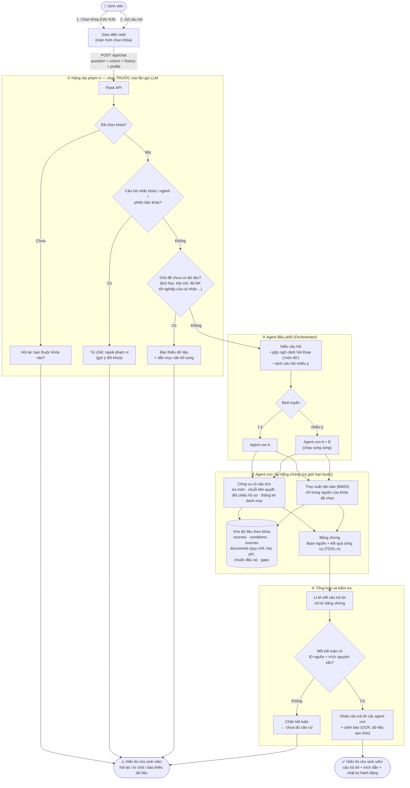
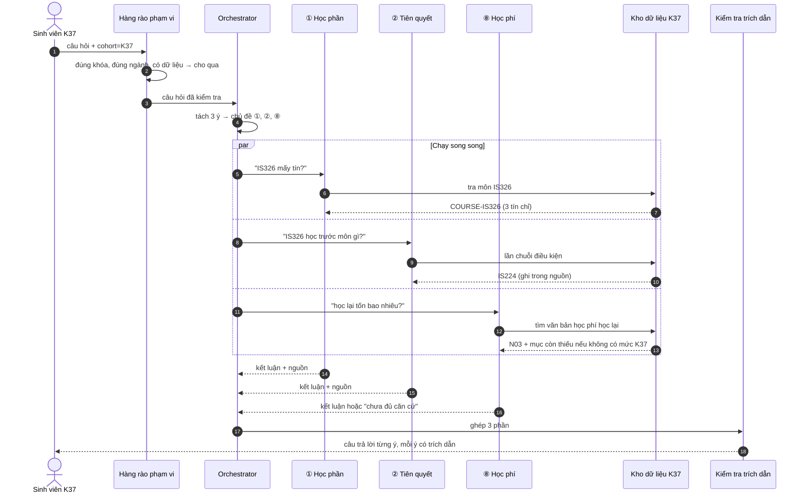
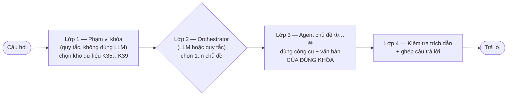

# Luồng dữ liệu và thiết kế đa agent (đề xuất)

Tài liệu mô tả đường đi của dữ liệu từ câu hỏi của sinh viên đến câu trả lời, và hai hướng chia
**agent điều phối (Orchestrator)** thành các **agent con**:

1. **Theo khóa** — mỗi khóa K35…K39 một agent.
2. **Theo cụm vấn đề** — 10 agent chuyên đề (điểm, kế hoạch học tập, quy chế…).

Cuối tài liệu là so sánh hai hướng và đề xuất kết hợp. Các khối Mermaid hiển thị trực tiếp trên
GitHub, VS Code (Markdown Preview Mermaid) hoặc https://mermaid.live.

> Trạng thái dữ liệu dùng trong sơ đồ là trạng thái hiện tại của kho (11/2026): K37 đã xác minh,
> K36 tạm thời (trích từ ảnh), K35/K38/K39 mới có thông tin phiên bản và toàn văn quy chế.

---

## 1. Luồng tổng quát: từ câu hỏi đến câu trả lời

**Ý chính**

- Hàng rào ① luôn chạy bằng quy tắc Python, không phụ thuộc LLM: khóa sai hoặc dữ liệu thiếu thì dừng sớm,
  không tốn token và không có cơ hội bịa.
- Agent con chỉ được đọc **kho dữ liệu của khóa đã chọn** — khóa là tham số bắt buộc, LLM không tự đổi.
- Số liệu (đếm môn, so sánh ngưỡng điểm/tín chỉ) do **công cụ** tính; LLM chỉ diễn đạt.

---

## 2. Hướng 1 — Agent con theo khóa

Mỗi agent khóa sở hữu đúng chương trình, phiên bản và văn bản áp dụng cho khóa đó.

| Ưu điểm | Nhược điểm |
|---|---|
| Cô lập dữ liệu rất rõ: agent K38 không thể "mượn" quy chế K37 | 5 agent có **cùng logic**, chỉ khác dữ liệu → trùng lặp prompt và code |
| Dễ giải thích phạm vi cho người dùng và hội đồng | Khóa đã được chọn ở giao diện, nên Orchestrator **không có gì để quyết định** — định tuyến tầm thường |
| Dễ cập nhật từng khóa độc lập | Không giúp hiểu câu hỏi tốt hơn: câu "học phí" và "tiên quyết" vẫn đi chung một agent |

---

## 3. Hướng 2 — Agent con theo cụm vấn đề (10 agent)

Khóa trở thành **tham số phạm vi** truyền cho mọi agent; Orchestrator quyết định *loại câu hỏi*.

### 3.1 Danh mục 10 chủ đề, dữ liệu và câu hỏi mẫu

| # | Agent chủ đề | Dữ liệu / công cụ | Câu hỏi sinh viên có thể hỏi |
|---|---|---|---|
| ① | **Học phần & tín chỉ** | Bảng học phần; công cụ tra môn, thống kê danh mục | "IT320 mấy tín chỉ?" · "Môn CSDL là môn nào?" · "Chương trình có bao nhiêu môn bắt buộc?" · "Nhóm lựa chọn ngành có những môn gì?" · "Học máy là môn bắt buộc hay tự chọn?" |
| ② | **Tiên quyết & lộ trình môn** | Bảng điều kiện; công cụ lần chuỗi, đối chiếu hồ sơ | "Muốn học Học máy phải qua môn gì?" · "Lộ trình để học Phân tích mã độc?" · "Tôi đạt CS122 rồi, học IT320 được chưa?" · "Rớt Giải tích 1 có học Giải tích 2 được không?" · "Học xong OOP thì học tiếp được môn nào?" |
| ③ | **Kế hoạch học tập & đăng ký học** | Quy chế (đăng ký học), kế hoạch đào tạo năm học, thông báo mẫu | "Một kỳ được đăng ký tối đa bao nhiêu tín chỉ?" · "Học kỳ phụ là gì, ai được đăng ký?" · "Kỳ đầu có phải tự đăng ký môn không?" · "Năm học 2026–2027 bắt đầu khi nào?" · "Nên phân bổ các môn cơ sở thế nào?" |
| ④ | **Điểm & đánh giá** | Quy chế (Điều đánh giá, thi lại, thang điểm) | "Điểm dưới bao nhiêu phải thi lại?" · "Điểm chữ B+ bằng bao nhiêu thang 4?" · "Điểm quá trình dưới 4 thì sao?" · "Học cải thiện điểm lấy điểm nào?" · "Phúc tra điểm thi nộp ở đâu, khi nào?" |
| ⑤ | **Cảnh báo & xử lý học vụ** | Quy chế (cảnh báo, buộc thôi học, nghỉ học tạm thời, bảo lưu) | "Khi nào bị cảnh báo học tập?" · "Nợ bao nhiêu tín chỉ thì bị buộc thôi học?" · "Bảo lưu kết quả học tập được bao lâu?" · "Nghỉ học tạm thời cần thủ tục gì?" · "Thời gian học tối đa là bao lâu?" |
| ⑥ | **Tốt nghiệp, thực tập, khóa luận** | Quy chế (công nhận, xếp hạng tốt nghiệp, khóa luận); điều kiện IP406/IT499; đối chiếu hồ sơ | "Điều kiện làm khóa luận là gì?" · "TBTL bao nhiêu thì tốt nghiệp loại giỏi?" · "Không làm khóa luận thì học gì thay?" · "Một năm xét tốt nghiệp mấy đợt?" · "Học lại nhiều có bị hạ hạng tốt nghiệp không?" |
| ⑦ | **Ngoại ngữ & chuẩn đầu ra** | TOEIC quốc tế (S04), chuẩn đầu ra 2023/2026 (N02/N01), quy đổi chứng chỉ | "Cần bao nhiêu điểm TOEIC để tốt nghiệp?" · "TOEIC 4 kỹ năng tính thế nào?" · "Chứng chỉ hết hạn có được xét không?" · "Có IELTS thì được miễn học tiếng Anh không?" · "K38 dùng chứng chỉ nào thay TOEIC được?" |
| ⑧ | **Học phí & lệ phí** | Học phí 2026–2027 (N03), học phí K39 (N04), học phí học lại, miễn giảm | "Học phí ngành CNTT K37 năm nay bao nhiêu?" · "Học phí K39 mỗi kỳ?" · "Học lại một môn tốn bao nhiêu?" · "Được miễn giảm học phí theo diện nào?" · "Lệ phí thi lại là bao nhiêu?" |
| ⑨ | **Chuyển ngành, song ngành & thủ tục** | Quy chế (chuyển ngành, học cùng lúc hai chương trình, trao đổi), thông báo thủ tục | "Muốn chuyển sang ngành Trí tuệ nhân tạo cần điều kiện gì?" · "Có được học song ngành không?" · "Môn đã học có được công nhận khi chuyển ngành?" · "Xin giấy xác nhận sinh viên ở đâu?" · "Chuyển trường có được không?" |
| ⑩ | **Chương trình đào tạo & phiên bản khóa** | VERSION-Kxx, khung CTĐT theo khóa, bản mô tả CTĐT | "Chương trình K38 bao nhiêu tín chỉ, học mấy năm?" · "Khung chương trình khóa mình theo quyết định nào?" · "K36 khác K37 ở những môn nào?" · "Chuẩn đầu ra của ngành CNTT là gì?" · "Dữ liệu của khóa mình đã đầy đủ chưa?" |
| — | *Thông tin theo thời điểm* (không phải agent trả lời) | Mục dữ liệu thiếu (gaps) | "Lịch thi kỳ này?" · "Lớp IT320 còn chỗ không?" · "Thầy nào dạy Python?" · "Em đủ điều kiện tốt nghiệp chưa?" (cần bảng điểm cá nhân) |

### 3.2 Ví dụ một câu hỏi nhiều ý đi qua hệ thống

> "Khai phá dữ liệu mấy tín, học trước môn gì, và nếu rớt thì học lại tốn bao nhiêu?" — sinh viên K37

---

## 4. So sánh và đề xuất cho đề tài

| Tiêu chí | Hướng 1: theo khóa | Hướng 2: theo chủ đề |
|---|---|---|
| Orchestrator có quyết định gì | Gần như không (khóa đã chọn ở UI) | Có: phân loại ý định, tách câu nhiều ý |
| Trùng lặp | Cao (5 agent cùng logic) | Thấp (mỗi agent một chuyên môn) |
| Prompt và công cụ | Chung chung | Chuyên biệt theo chủ đề → chính xác hơn |
| Cô lập dữ liệu theo khóa | Tự nhiên | Phải truyền khóa làm bộ lọc (đã có sẵn trong catalog) |
| Đánh giá trong NCKH | Khó tạo khác biệt | Đo được độ chính xác định tuyến theo chủ đề |

**Đề xuất: kết hợp — khóa là *phạm vi*, chủ đề là *agent*.**

- **Lớp 1** chính là hàng rào đã có (`DemoEngine`, `Catalog` theo khóa) — giữ nguyên.
- **Lớp 2** mở rộng `planner.py` / `llm_agent.py`: thay vì chọn công cụ trực tiếp, chọn chủ đề;
  có thể so sánh định tuyến bằng quy tắc với định tuyến bằng LLM như thực nghiệm đã làm.
- **Lớp 3** mỗi agent chỉ có 2–4 công cụ liên quan và prompt riêng (ví dụ agent ④ biết thang điểm
  10/4, agent ⑦ biết chứng chỉ phải còn hiệu lực) → ít nhầm công cụ hơn agent lớn duy nhất.
- **Thực nghiệm gợi ý:** gán nhãn chủ đề ①…⑩ cho bộ đánh giá, đo (a) độ đúng định tuyến,
  (b) độ đúng câu trả lời theo từng chủ đề, (c) chi phí — so với Agentic RAG một agent hiện tại.
