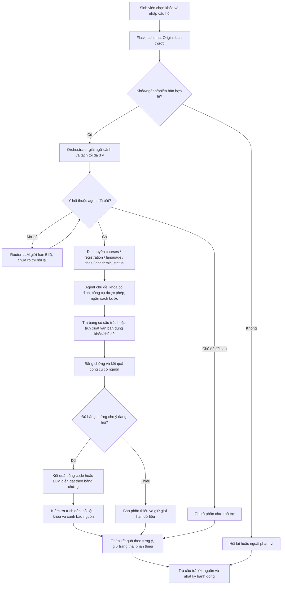
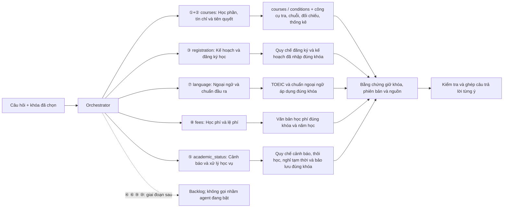

# Kế hoạch triển khai giai đoạn 1 — 5 agent theo chủ đề

Kế hoạch tổng được giữ nguyên tại [AGENT_ROUTING.md](AGENT_ROUTING.md), lấy từ
GitHub `origin/main` (commit `c661dac`). Tệp này ghi riêng phạm vi ưu tiên
và thứ tự triển khai giai đoạn đầu theo phương án 2, không thay thế kế hoạch tổng
hoặc loại bỏ các chủ đề sẽ phát triển sau.

**Kế hoạch đã chốt ngày 04/11/2026:** giữ **một Orchestrator**, triển khai giai đoạn đầu
với **5 agent chủ đề**. Các số ①…⑩ bên dưới là số **chủ đề gốc**, không phải số mục của tài liệu.

| Ưu tiên | Agent giai đoạn đầu | Chủ đề gốc | ID đề xuất |
|---|---|---|---|
| 1 | Học phần, tín chỉ & tiên quyết | **Gộp ① + ②** | `courses` |
| 2 | Kế hoạch học tập & đăng ký học | **③** | `registration` |
| 3 | Ngoại ngữ & chuẩn đầu ra | **⑦** | `language` |
| 4 | Học phí & lệ phí | **⑧** | `fees` |
| 5 | Cảnh báo & xử lý học vụ | **⑤** | `academic_status` |

Chủ đề **④ Điểm**, **⑥ Tốt nghiệp tổng quát**, **⑨ Thủ tục** và
**⑩ Chương trình/so sánh phiên bản khóa** thuộc giai đoạn sau. Hoàn thành và đánh giá năm
agent ưu tiên trước khi mở rộng. So sánh K36–K37 chưa nằm trong phạm vi triển khai đợt này.

**Khóa K35–K39 là bộ lọc dữ liệu bắt buộc**, do hệ thống truyền vào agent; mỗi yêu cầu
thông thường chỉ dùng một khóa đã chọn. Người dùng giao diện chính không cần chọn `mode`;
backend mặc định luồng điều phối, giữ LLM/RAG/Agent cho thực nghiệm đối chứng.

**Trạng thái:** đây là kế hoạch triển khai. Các module `agents/` có ký hiệu 🆕 là phần cần
xây dựng; việc chốt tài liệu không có nghĩa năm agent đã chạy trong mã nguồn.
✅ thành phần hiện có để tái sử dụng · 🆕 phần cần bổ sung.

> Dữ liệu kiểm tra ngày 04/11/2026: K37 có 99 mã (`verified_snapshot`); K36 có 72 mã
> từ ảnh (`provisional_snapshot`), chưa đối chiếu quyết định gốc. K35/K38/K39 chưa có
> danh mục môn có thể dùng bằng công cụ, nhưng có thể có văn bản đúng phạm vi cho các
> chủ đề khác. `covered_topics` cho biết đã nhập văn bản, không bảo đảm đủ căn cứ cho
> mọi câu hỏi hoặc mọi số liệu OCR.

---

## 1. Luồng dữ liệu tổng quát (theo phương án 2)



Nhánh hỏi lại phải dừng lượt hiện tại, không lặp router vô hạn. Thiếu bảng môn của một
khóa chỉ chặn phần tra học phần; các ý về quy chế/ngoại ngữ/học phí/học vụ vẫn xét văn bản của
chính khóa đó. Lịch lớp mở, sĩ số, lịch thi và kết luận đủ điều kiện tốt nghiệp cá nhân
vẫn cần dữ liệu ngoài phạm vi hiện có.

---

## 2. Phương án 2 — Agent con theo cụm vấn đề (đã chọn)



### 2.1 Vì sao gộp ① với ②

**Gộp là hợp lý:** hai chủ đề cùng xoay quanh học phần, dùng chung `Catalog`,
`courses.json`, `conditions.json` và các mã môn. Câu hỏi tự nhiên thường hỏi liền
"mấy tín chỉ, học trước môn nào, tôi có đủ điều kiện học không"; một agent xử lý sẽ
ít chia cắt ngữ cảnh và tránh truy xuất trùng.

Trong agent gộp vẫn giữ các thao tác riêng:

| Thao tác | Công cụ | Nguyên tắc |
|---|---|---|
| Tra tên, tín chỉ, nhóm | `lookup_course` | Đọc bản ghi đúng khóa/phiên bản |
| Đọc điều kiện/chuỗi | `get_conditions` | Chỉ thuật lại quan hệ và điều kiện nguồn ghi |
| Đối chiếu hồ sơ cho một môn | `check_prerequisites` | Python đánh giá; thiếu/không rõ giữ unknown |
| Đếm/liệt kê danh mục | `catalog_summary` | Đọc toàn danh mục, không đếm từ top-k |

Một agent có thể được phép dùng cả bốn công cụ nhưng chỉ gọi những công cụ cần cho
câu hỏi. Gộp vai trò không đồng nghĩa trộn kết luận tra cứu với kết luận đủ điều kiện.

### 2.2 Ranh giới giữa năm agent

| Ranh giới | Cách xử lý đã chốt |
|---|---|
| Tiên quyết một môn và đăng ký học kỳ | Điều kiện IT320 thuộc `courses`; quy định số tín chỉ tối thiểu/tối đa một kỳ thuộc `registration` |
| Lộ trình môn và kế hoạch học tập | Chuỗi tham chiếu môn thuộc `courses`; quy tắc lập kế hoạch/đăng ký thuộc `registration`; chưa tạo lịch học khả thi khi không có lớp mở |
| Học phần ngoại ngữ và chứng chỉ | Tín chỉ môn GE/GF… thuộc `courses`; TOEIC/IELTS/chuẩn đầu ra thuộc `language` |
| Học lại và học phí học lại | Số tiền thuộc `fees`; quy tắc tính điểm học lại/cải thiện thuộc ④, để sau |
| Học phần tốt nghiệp và tốt nghiệp tổng quát | Thông tin/điều kiện ghi cho IP406/IT499 có thể tra như môn trong `courses`; xếp hạng, xét đợt và kết luận tốt nghiệp tổng thể thuộc ⑥, để sau |
| Ngoại ngữ để tốt nghiệp | Điều kiện ngoại ngữ chung có nguồn thuộc `language`, dù câu có từ “tốt nghiệp”; không kết luận sinh viên đủ toàn bộ điều kiện tốt nghiệp |
| Cảnh báo học vụ và điểm số | Điều kiện cảnh báo/buộc thôi học thuộc `academic_status`; thang điểm, cách tính điểm học lại/cải thiện thuộc ④, để sau |
| Cảnh báo và giới hạn đăng ký | Quy định cảnh báo thuộc `academic_status`; giới hạn tín chỉ đăng ký khi bị cảnh báo thuộc `registration`; câu có cả hai ý được phối hợp hai agent |
| Nghỉ học/bảo lưu và thủ tục khác | Điều kiện, thời hạn và thủ tục nghỉ học/bảo lưu có nguồn thuộc `academic_status`; chuyển ngành/song ngành/chuyển trường và thủ tục hành chính khác thuộc ⑨, để sau |
| Quy định và quyết định xử lý cá nhân | Có thể nêu tiêu chí chung có nguồn; chưa kết luận sinh viên bị cảnh báo/buộc thôi học khi thiếu lịch sử học kỳ, số lần cảnh báo hoặc quyết định chính thức |
| Câu hỏi nhiều chủ đề | Tách từng ý cho agent phù hợp; phần thuộc chủ đề chưa bật được ghi rõ là chưa hỗ trợ |

---

## 3. Phạm vi giai đoạn đầu và câu hỏi mẫu

| Agent đang ưu tiên | Câu hỏi xử lý | Dữ liệu/công cụ | Giới hạn |
|---|---|---|---|
| **①+② courses** | "IT320 mấy tín chỉ và tiên quyết gì?"; "Tôi đạt CS122 rồi có học IT320 được không?"; "Có bao nhiêu môn bắt buộc?" | Bảng học phần, điều kiện, bốn công cụ tại §2.1 | Mã trần/ô trống không suy ra đủ điều kiện; giữ cảnh báo K36 tạm thời |
| **③ registration** | "Một kỳ đăng ký tối đa bao nhiêu tín chỉ?"; "Học kỳ phụ là gì?"; "Quy định rút học phần thế nào?" | Quy chế/kế hoạch đúng khóa, điều khoản đăng ký | Không bịa lịch học, lớp còn chỗ hoặc thời hạn của đợt chưa có thông báo |
| **⑦ language** | "Khóa tôi cần chuẩn ngoại ngữ nào?"; "TOEIC yêu cầu kỹ năng gì?"; "Chứng chỉ hết hạn có được dùng không?" | TOEIC S04, chuẩn ngoại ngữ N01/N02 và văn bản liên quan đã nhập | Kiểm tra khóa, ngày hiệu lực và tình trạng OCR; không suy ra công nhận/miễn học khi thiếu quy định |
| **⑧ fees** | "Học phí CNTT khóa tôi năm học 2026–2027 bao nhiêu?"; "Học lại tính tiền thế nào?" | Học phí N03/N04 và văn bản liên quan đã nhập | Phân biệt theo tín chỉ/học kỳ/năm học; không nhân tiền nếu thiếu đơn giá, công thức hoặc dữ liệu đầu vào |
| **⑤ academic_status** | "Khi nào bị cảnh báo học tập?"; "Trường hợp nào bị buộc thôi học?"; "Bảo lưu được bao lâu?"; "Nghỉ học tạm thời cần điều kiện gì?" | Điều khoản học vụ trong quy chế đúng khóa S03/S05/S06 và thông báo liên quan đã nhập | Nêu đúng điều kiện AND/OR, mức điểm/tín chỉ, số lần và thời hạn; thiếu lịch sử hoặc quyết định thì không kết luận xử lý cá nhân |

**Chủ đề để phát triển sau:** ④ Điểm & đánh giá; ⑥ Tốt nghiệp tổng quát;
⑨ Chuyển ngành/song ngành/thủ tục; ⑩ CTĐT & so sánh phiên bản.
Không route các câu này sang một agent đang bật chỉ vì có một từ khóa trùng.

### Ví dụ câu hỏi nhiều ý sau khi gộp

> "Khai phá dữ liệu mấy tín, học trước môn gì, và nếu rớt thì học lại tốn bao nhiêu?" — sinh viên K37

```mermaid
sequenceDiagram
    actor SV as Sinh viên
    participant O as Orchestrator
    participant A as courses (①+②)
    participant F as fees (⑧)
    participant V as Kiểm tra và ghép
    SV->>O: Câu hỏi + cohort=K37
    O->>O: Giữ chủ ngữ chung; tách ý học phần/tiên quyết và ý tiền học lại
    par Hai tác vụ độc lập ban đầu
        O->>A: Tra tín chỉ và điều kiện IS326 trong K37
        A-->>O: Bản ghi môn + điều kiện + nguồn
    and
        O->>F: Tìm quy định học phí học lại đúng khóa và năm học
        F-->>O: Mức/công thức có nguồn hoặc báo thiếu
    end
    O->>O: Nếu cần dùng tín chỉ từ A để tính tiền, chờ dữ liệu phụ thuộc
    O->>V: Ghép các ý; chỉ tính bằng Python khi đủ đơn giá và công thức
    V-->>SV: Câu trả lời từng ý + nguồn + phần chưa đủ căn cứ
```

Không phải câu nhiều ý nào cũng cần ba agent: tín chỉ và tiên quyết đã cùng một agent.
Các nhánh độc lập có thể chạy song song; nhánh cần kết quả của nhánh khác phải chờ đủ
đầu vào. Nếu chỉ có đơn giá chung mà chưa rõ cách thu học lại thì phần tiền phải báo thiếu.

---

## 4. Chi tiết triển khai theo thứ tự ưu tiên

### 4.0 Module và cấu hình

```text
src/agentic_rag/agents/
    taxonomy.py      # 5 agent: ID, aliases chủ đề cũ, công cụ, chủ đề nguồn, enabled
    orchestrator.py  # giải ngữ cảnh, tách ý, định tuyến, phụ thuộc và ngân sách tổng
    topic_agent.py   # chạy agent theo cấu hình, khóa cố định và công cụ được phép
    merge.py         # ghép theo từng ý, nguồn và trạng thái đầy đủ/một phần
```

Giữ ID ổn định `courses`, `registration`, `language`, `fees`, `academic_status`. Bản đồ chủ đề cũ:
①→courses, ②→courses, ③→registration, ⑤→academic_status, ⑦→language, ⑧→fees. Chủ đề để sau chưa
nằm trong enum mà router được phép kích hoạt. Mỗi mốc chỉ bật agent đã đạt tiêu chí.

### 4.1 Nền dữ liệu và hàng rào phạm vi

| Thành phần | Cách dùng trong giai đoạn đầu |
|---|---|
| ✅ `Catalog`, `source_applies()`, `usable` | Cố định khóa/chương trình/phiên bản ở Python; giữ nguồn chung có phạm vi đã xác minh và cảnh báo dữ liệu tạm thời |
| ✅ Workbook, JSON và văn bản đã nhập | Dùng dữ liệu hiện có; không tự thu thập/import/OCR lại khi triển khai routing |
| ✅ `covered_topics` | Giúp nhận diện đã có văn bản cho chủ đề; vẫn phải kiểm tra đủ bằng chứng cho câu hỏi cụ thể |
| 🆕 Nhãn chủ đề cho đoạn văn | Tạo nhãn trong bộ nhớ hoặc chỉ mục dẫn xuất từ dữ liệu hiện có; một đoạn có thể nhiều chủ đề, không sửa nguyên văn/bản nguồn |
| ✅ Schema, Origin, body | Giữ câu hỏi ≤3.000 ký tự, lịch sử ≤6 câu, body ≤32 KB và yêu cầu chọn khóa |
| ✅ Lịch sử theo khóa | Không kế thừa chủ ngữ từ khóa/ngành khác; câu tiếp nối mơ hồ thì hỏi lại |
| 🆕 Phạm vi chủ đề đang bật | Thêm kết quả “chủ đề chưa triển khai”; phân biệt với “đã hỗ trợ chủ đề nhưng thiếu bằng chứng” |

Chưa mở phạm vi so sánh nhiều khóa ở bước này. Một yêu cầu thiếu danh mục môn vẫn có
thể xử lý phần văn bản của đúng khóa; không coi `courses` rỗng là mọi chủ đề đều không có dữ liệu.

### 4.2 Orchestrator

1. Nhận câu hỏi, khóa cố định, hồ sơ giả lập và lịch sử.
2. Giải ngữ cảnh: mã môn/tập môn đang nói tới; chưa rõ thì yêu cầu làm rõ.
3. Tách tối đa ba ý, giữ mã môn và các mốc năm học liên quan cho từng ý.
4. Route bằng quy tắc vào năm ID đã bật; gộp các ý tín chỉ/tiên quyết cùng môn cho `courses`.
5. Khi mơ hồ, dùng `provider.chat()` với schema `route_topics` giới hạn đúng các ID đang bật.
6. Kết quả ngoài enum bị từ chối. Vẫn mơ hồ thì hỏi lại; chủ đề để sau trả trạng thái chưa hỗ trợ.
7. Lập các tác vụ độc lập/phụ thuộc, chạy và ghép kết quả theo thứ tự ý hỏi.

Không dùng agent tổng quát để âm thầm trả lời chủ đề đã quyết định hoãn. Agent tổng quát
hiện có được giữ làm baseline nghiên cứu; quyền công cụ/phạm vi của luồng mới do Python kiểm soát.

### 4.3 Công cụ được phép theo agent

| Agent | Công cụ | Nguồn/bộ lọc | Quy tắc |
|---|---|---|---|
| `courses` | `lookup_course`, `get_conditions`, `check_prerequisites`, `catalog_summary` | `courses`, `conditions`, đoạn học phần đúng khóa | Số đếm/trạng thái do Python; chuỗi ≤2 cạnh/25 nút; không tự gán ngưỡng cho mã trần |
| `registration` | Truy xuất văn bản | Điều khoản đăng ký/kế hoạch trong quy chế đúng khóa | Mốc theo đợt phải có ngày/năm học; không suy ra lịch lớp mở |
| `language` | Truy xuất văn bản | `toeic`, `chuan_dau_ra`; nguồn áp dụng đúng khóa | Phân biệt kỹ năng, loại chứng chỉ, ngưỡng, hiệu lực và đối tượng áp dụng |
| `fees` | Truy xuất văn bản; phép tính có kiểm soát khi đủ căn cứ | `hoc_phi`, đúng khóa/năm học/đơn vị thu | Tra nguồn trước; tính bằng Python; không để LLM tự suy đoán công thức hoặc miễn giảm |
| `academic_status` | Truy xuất văn bản | `hoc_vu`: cảnh báo, buộc thôi học, nghỉ học tạm thời, bảo lưu và thời gian học trong quy chế đúng khóa | Trích đủ điều kiện và ngoại lệ; phân biệt TBTL/điểm học kỳ, số lần và thời hạn; không dùng hồ sơ môn học đơn giản để ra quyết định học vụ cá nhân |

✅ Tái sử dụng `llm_agent.py` cho vòng function calling và `AcademicTools` cho công cụ có
cấu trúc. 🆕 `TopicAgent` chỉ đưa các schema được phép vào model và còn kiểm tra lại ở
executor. `cohort`/`profile` do hệ thống truyền, không cho LLM tự sửa tham số này.

### 4.4 Truy xuất và ngân sách

- ✅ BM25 không dấu, `top_k=4`; mã môn được ưu tiên. Số đoạn không phải tổng danh mục.
- 🆕 Thêm bộ lọc chủ đề ở retriever hoặc tạo view trước khi xếp hạng; luôn giữ khóa,
  phiên bản và nguồn áp dụng. Thiếu nhãn chủ đề có thể tìm rộng trong cùng khóa,
  nhưng không mở sang khóa khác hoặc coi mọi đoạn tìm được là bằng chứng phù hợp.
- 🆕 Bảng đồng nghĩa nhỏ: “rớt/không đạt”, “học trước/tiên quyết”, “TBTL/trung bình tích lũy”.
- ✅ Giữ mức hiện có theo một agent: tối đa 4 lượt lập kế hoạch, 6 lần gọi công cụ,
  2 lần tìm kiếm; đếm danh mục bằng công cụ, không gọi retriever để đếm.
- 🆕 Orchestrator kích hoạt tối đa 3 agent trong một yêu cầu, không tăng ngân sách
  ngầm khi ghép; ghi cả ngân sách từng nhánh và tổng yêu cầu. Các trần tương ứng
  khi có đủ 3 agent là 12 lượt lập kế hoạch, 18 lần công cụ, 6 lần tìm kiếm.
- Chỉ bật chạy song song sau khi các nhánh chạy tuần tự đã qua kiểm tra; giữ phụ
  thuộc khi một nhánh cần kết quả nhánh khác. Có thể dùng `ThreadPoolExecutor(max_workers=3)`.
- Hybrid/embedding Gemini và tách từ nâng cao là tối ưu sau; chưa phải điều kiện
  hoàn thành năm agent ưu tiên. Không tạo lại dữ liệu nguồn cho việc thử routing.

### 4.5 Tạo câu trả lời và kiểm tra

| Việc | Kế hoạch |
|---|---|
| ✅ Sinh JSON có nguồn | Tái sử dụng `provider.generate()`, cấu trúc claim/evidence_id/quote |
| ✅ Kiểm tra ID/quote | Tái sử dụng `validate_generation()`; đoạn gap không dùng để khẳng định answered |
| 🆕 Kiểm tra số liệu và phạm vi | Kiểm tra đúng khóa/phiên bản; số liệu và đơn vị phải có căn cứ; đối chiếu kết quả số học với công cụ, không chỉ dựa vào việc một con số xuất hiện đâu đó trong quote |
| ✅ Kết quả công cụ | Giữ nguyên số đếm, điều kiện và trạng thái đối chiếu do Python tính; sử dụng bằng chứng TOOL-n khi phù hợp |
| 🆕 Ghép từng ý | Giữ thứ tự, nguồn và trạng thái từng phần; có phần trả lời và phần thiếu/để sau thì thể hiện trả lời một phần, không gắn nhãn hoàn chỉnh |
| 🆕 Cảnh báo | Giữ K36 tạm thời, OCR_UNREVIEWED và giới hạn nguồn ngay tại phần có liên quan |
| ✅ Xử lý lỗi API | Tái sử dụng retry/backoff có giới hạn đang có trong provider; lỗi một nhánh không làm mất phần đã có căn cứ của nhánh khác |
| 🆕 Nhật ký | Ghi router, agent_id, câu con, công cụ, lượt tìm kiếm, token, thời gian và trạng thái từng nhánh; đây là action log, không phải suy luận nội bộ |

Kiểm tra ID/quote là điều kiện cần, chưa chứng minh mọi kết luận đều được nguồn hỗ trợ.
Học phí, ngưỡng ngoại ngữ, tiêu chí xử lý học vụ và đề xuất kế hoạch phải có ca đánh giá ngữ nghĩa riêng.

### 4.6 Các mốc triển khai và điều kiện chuyển mốc

| Mốc | Làm gì | Chỉ chuyển tiếp khi |
|---|---|---|
| **0 — Nền điều phối** | Tạo taxonomy 5 ID, cờ enabled, giao diện đầu vào/đầu ra, hàng rào khóa và nhãn truy xuất | Chỉ bật ID được phép; thiếu khóa/khác khóa/chủ đề để sau được xử lý đúng; code cũ có bộ hồi quy |
| **1 — ①+② courses** | Tra môn, thống kê, chuỗi điều kiện và đối chiếu hồ sơ; giữ các thao tác tách biệt trong agent gộp | Đúng mã/tín chỉ/nguồn; thống kê toàn danh mục; không biến ô trống/mã trần thành đủ điều kiện; giữ ngữ cảnh; cảnh báo K36 |
| **2 — ③ registration** | Điều khoản đăng ký, học kỳ phụ, rút môn và quy định kế hoạch | Phân biệt điều kiện môn với quy định học kỳ; đúng nguồn/khóa; thiếu lớp mở hoặc thời hạn đợt thì báo thiếu |
| **3 — ⑦ language** | Chuẩn ngoại ngữ, TOEIC/chứng chỉ và phạm vi áp dụng | Đúng loại/kỹ năng/ngưỡng/đơn vị/hiệu lực; OCR chưa chắc phải nêu; không suy ra đủ toàn bộ điều kiện tốt nghiệp |
| **4 — ⑧ fees** | Học phí/lệ phí theo khóa và năm học; phép tính khi nguồn đủ | Đúng số tiền/đơn vị/năm học; không tính nếu thiếu công thức; phân biệt học lại về tiền với chủ đề điểm số để sau |
| **5 — ⑤ academic_status** | Cảnh báo, buộc thôi học, nghỉ học tạm thời/bảo lưu và thời gian học theo quy chế | Đúng nguồn/khóa, đủ điều kiện và ngoại lệ; phân biệt các loại điểm/số lần; thiếu lịch sử hoặc quyết định thì không kết luận cá nhân |
| **6 — Ghép và đánh giá năm agent** | Câu nhiều ý, phụ thuộc, lỗi từng nhánh; tối ưu router và sau đó mới chạy song song | Không mất ý/nguồn; trạng thái từng phần rõ; toàn bộ hồi quy và bộ đánh giá của năm agent đạt ngưỡng đã chốt |

Chỉ sau mốc 6 mới lên kế hoạch phát triển các chủ đề ④,⑥,⑨,⑩.

### 4.7 Kiểm thử và đánh giá nghiên cứu

- Viết bộ dev có nhãn cho từng agent, các câu giáp ranh, câu thiếu dữ liệu và câu nhiều ý.
  Lưu nhãn agent, thao tác mong đợi, phạm vi và nguồn chuẩn; không chỉ kiểm tra khớp từ khóa.
- Kiểm tra ranh giới: “học lại mất bao nhiêu tiền” → fees; “điểm học lại lấy lần nào” → ④
  chưa bật; “TOEIC để tốt nghiệp” → language; “xếp loại tốt nghiệp” → ⑥ chưa bật.
- Kiểm tra học vụ: “khi nào bị cảnh báo” → academic_status; “điểm B+ thang 4 bao nhiêu”
  → ④ chưa bật; “bị cảnh báo được đăng ký bao nhiêu tín chỉ” → registration hoặc tách
  hai ý phối hợp khi hỏi cả tiêu chí cảnh báo. Kiểm tra bảo lưu/nghỉ tạm thời đúng nguồn.
- Không kết luận “em bị buộc thôi học” chỉ từ một điểm trung bình/tổng tín chỉ; thiếu
  lịch sử học kỳ, số lần cảnh báo hoặc căn cứ quyết định phải ghi rõ chưa đủ dữ liệu.
- Kiểm tra các câu “mấy tín, tiên quyết gì” chỉ dùng một agent courses; “môn đó” không
  mượn lịch sử khóa khác; hỏi nhiều ý vẫn giữ chủ ngữ và thứ tự.
- Kiểm tra thiếu một phần/lỗi API một nhánh không làm mất phần hợp lệ, không gọi tool
  ngoài allowlist, không vượt ngân sách và không đưa câu chưa hỗ trợ vào agent gần nhất.
- Chạy các bài phần mềm và hồi quy hiện có; chạy tập dev trước khi mở rộng dữ liệu/test.
  Kiểm thử ngoại tuyến dùng mock, thử API thật được ghi riêng; nhãn OCR/tạm thời phải giữ.
- So sánh baseline agent đơn với năm agent, router quy tắc với router có LLM dự phòng.
  Đo định tuyến, đúng nội dung, trích dẫn, từ chối đúng, token và thời gian.
  Dùng cùng tổng ngân sách trong các phép đối chứng hoặc công bố rõ khác biệt ngân sách.

### 4.8 Phạm vi công việc hiện tại

Tài liệu này chốt thiết kế và thứ tự triển khai. Bước triển khai đầu tiên là mốc 0 rồi
mốc 1 (agent gộp courses). Chưa đánh dấu các module agents/ là đã hoàn thành, chưa mở
agent thuộc backlog và chưa đưa so sánh nhiều khóa vào luồng trả lời thông thường.
