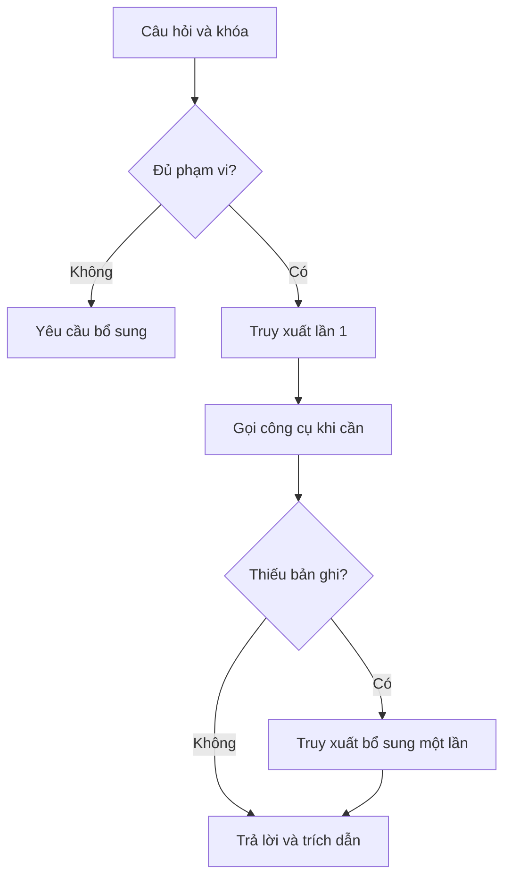

# Thiết kế prototype v0.2

Căn cứ: đề cương chỉnh theo nhận xét 29/09/2026 và đề xuất đồng bộ; danh mục
`Danh_muc_nguon_va_hoc_phan_CNTT_K37.xlsx` ngày 07/10/2026.
Phạm vi mục tiêu: CNTT toàn khóa; giai đoạn đầu K35–K39. Dữ liệu học phần thật hiện có K37. Không lấy thông tin cá nhân từ đề cương vào dữ liệu demo.

1. **RAG một lượt**: nhận khóa → lọc scope → BM25 hoặc hybrid → top-k cố định
   → sinh/trích xuất câu trả lời → kiểm tra ID và quote → trả nguồn, trang/mục.
2. **Công cụ**: tra mã/tên học phần; đánh giá điều kiện bằng mã chương trình,
   không để LLM tự tính tiên quyết. Kết quả là đối chiếu snapshot, không cấp phép đăng ký.
3. **Agent giới hạn**: router xác định loại câu → truy xuất lần 1 → công cụ khi cần
   → kiểm tra mã/đoạn còn thiếu → tối đa một lần truy xuất bổ sung → trả lời.
4. **Demo web**: hội thoại, hồ sơ giả lập, đổi cấu hình đối chứng, lịch sử ở trình
   duyệt, mở đoạn nguồn và liên kết văn bản, nhật ký hành động công khai.

## Quyết định triển khai

| Thành phần | Quyết định | Lý do/giới hạn |
|---|---|---|
| Runtime | Python >=3.10, thư viện chuẩn; HTML/CSS/JS | Chạy offline trên Windows, không cần GPU/build frontend |
| Offline | BM25 không dấu + trích đoạn | Kiểm thử wiring; không gọi đây là kết quả LLM RAG cuối |
| API | GPT-4.1 mini + text-embedding-3-small cấu hình được | Cùng provider/model/retriever cho các đối chứng |
| Vector | Cosine chính xác, RRF với BM25 | Chỉ mục riêng theo khóa/phiên bản, chưa cần FAISS; thay index khi đủ toàn văn |
| Router | Quy tắc rõ ràng, trạng thái hữu hạn | Agent nguyên mẫu có tool use, không giả vờ planner học được |
| Vòng truy xuất | RAG=1; Agent=1 hoặc 2 | Lượt 2 phải ghi query và lý do; không đệ quy |
| Trích dẫn | ID đoạn, excerpt, trang, mục, URL, khóa, hiệu lực | Quote được kiểm tra tồn tại; entailment vẫn cần chấm tay |
| Lịch sử | localStorage; nút xóa | Chỉ hồ sơ giả lập; không nối tài khoản/bảng điểm thật |
| Theo dõi | latency, rounds, calls, token API, fingerprint | Không đoán token hoặc đơn giá; index token tách riêng |

## Dữ liệu hiện có và thiếu

99 mã chuẩn hóa, 100 dòng gốc, 76 điều kiện, 12 nguồn trong danh mục. Giữ cả hai
dòng IT334 trong `raw_rows.json`, một mã trong `courses.json`. `SOURCE_BLANK`
giữ null, không phải danh sách tiên quyết rỗng đã xác minh. `COURSE_CODE` giữ
nguyên nghĩa chưa xác minh; không chuyển thành điểm >=4 hay học trước/đạt môn.
S05–S12 không được dùng làm nội dung áp dụng K37. S04 chỉ có metadata phạm vi,
chưa có ngưỡng TOEIC để trả lời câu hỏi điểm. Chưa nhập toàn văn PDF/HTML; đoạn
nguồn hiện là bảng chép và tóm tắt danh mục, được gắn nhãn đúng mức chứng cứ.

`data/project` giữ dữ liệu có nguồn. `data/sample` độc lập, toàn bộ giả lập và luôn
hiển thị nhãn. Không trộn mẫu vào kết luận về TLU. Có AND/OR ở fixture để kiểm
thử logic; quan hệ chưa được xác minh trong project không được tự tạo.

## Mở rộng sau prototype

Nhập bản gốc đã được phép công bố, chia theo điều/mục, đối chiếu nguyên văn và ngày
hiệu lực; xác minh sửa đổi và nghĩa của COURSE_CODE. Sau đó khóa tập phát triển
20–30 câu và tập kiểm tra 100–120 câu tách biệt, chấm chéo theo đề cương. Các bài
kiểm tra phần mềm và smoke cases hiện tại không thay thế bộ đánh giá nghiên cứu.
